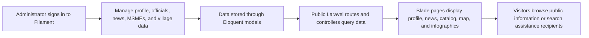
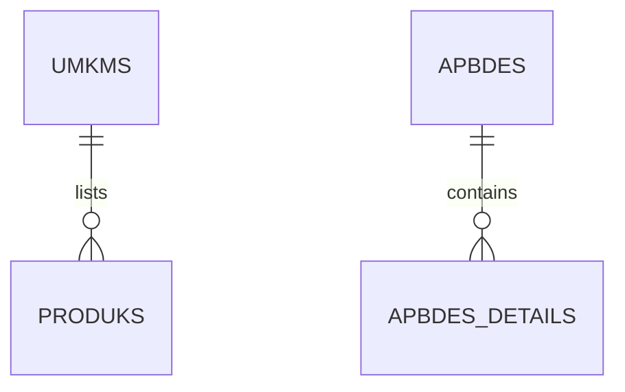

# Desa Sukamaju Information Website

A Laravel and Filament application for presenting village information and managing public-facing content and village datasets, including news, village profile, MSMEs, products, maps, and statistical infographics.

## Project Overview

The website provides public pages for the village profile, news, MSME products, map locations, and infographics. A Filament admin panel supports maintenance of content and structured village data. Statistical pages can display data for a selected year or default to the latest available year, depending on the page.

The repository is a fork of [yasfachrezyy/Sistem-Informasi-DesaSukamaju](https://github.com/yasfachrezyy/Sistem-Informasi-DesaSukamaju). The project-specific source inspected here includes additional or customized Filament resources, dashboard widgets, controllers, views, and migrations. User ownership and contribution distribution cannot be inferred from the code alone.

## Key Features

### Public village information
- Homepage displays village profile, officials, recent news, and APBDes/demographic summaries.
- Profile page presents village history, vision/mission, territory description, and officials.
- News listing and detail routes use article slugs.

### MSME and product catalog
- Public page lists products together with their associated MSME.
- Product detail route uses Laravel model binding by product slug.
- Admin resources manage MSMEs and products, including images, descriptions, categories, prices, and owner associations.

### Village infographics
- Public pages cover population/demographics, APBDes, stunting, social assistance, IDM, and SDGs.
- Several infographic controllers expose available year values and select a requested year, defaulting to the latest available year.
- The social-assistance page searches recipients by NIK and shows current/latest-year assistance summary data.

### Interactive village map
- The public map displays stored points of interest, with markers and a location list.
- Selecting a location in the list centers/zooms the map and opens the corresponding marker popup.
- The inspected public map view uses Leaflet and OpenStreetMap tile URLs. Although a Filament Google Maps package is declared, this README does not claim that public map rendering uses Google Maps.

### Filament administration
- Admin panel login is enabled at `/admin` using Filament's authentication middleware.
- Resources manage village profile, village officials, news, APBDes and details, demographics, social assistance and recipients, products, MSMEs, IDM, SDGs, and stunting.
- Dashboard widgets include statistics, gender chart, APBDes chart, and a hero widget.
- No custom role/permission system beyond the Filament panel authentication was verified.

## Application Workflow



### User groups

- **Administrator:** signs into the Filament panel and manages content/data through available resources and dashboard widgets.
- **Public visitor:** browses village information, news, products, infographics, and map locations. No public account workflow was found in the routes inspected.

## Technology Stack

| Category | Technology | Purpose |
|---|---|---|
| Backend | PHP `^8.2`, Laravel `^12.0` | Web framework, routing, controllers, validation, and data access; versions from `composer.json`. |
| Frontend | Blade, Vite `^7.0.4`, Tailwind CSS `^4.0.0` | Server-rendered pages and frontend asset build; versions from repository dependency files. |
| Admin panel | Filament `^3.2` | Login-protected data resources, forms, tables, and dashboard. |
| ORM/database | Eloquent; SQLite default with MySQL driver available | Relational data models and migrations. `.env.example` defaults to SQLite; the active runtime database was not inspected. |
| Map | Leaflet 1.9.4 and OpenStreetMap tiles on the public map page | Renders public point-of-interest markers. The Leaflet references are in `resources/views/peta-desa.blade.php`. |
| Admin map dependency | `cheesegrits/filament-google-maps` `^3.0` | Installed dependency. Specific use in the inspected resources was not confirmed, so it is not described as an implemented user-facing map integration. |
| Testing | PHPUnit `^11.5.3`, Laravel test runner | Test harness and example tests are present; feature-specific coverage is limited in the inspected tree. |

## Project Architecture

The application uses Laravel's MVC conventions. Filament resources provide the admin CRUD interfaces, while public routes use controllers and Blade views.

```text
app/
├── Filament/
│   ├── Pages/                # Custom admin dashboard
│   ├── Resources/            # Admin CRUD resources
│   └── Widgets/              # Statistics and charts
├── Http/Controllers/         # News, shopping, profile, map, and infographic flows
├── Models/                   # Village content and dataset models
└── Providers/Filament/       # Filament panel configuration
resources/
├── views/                    # Public Blade pages and Filament custom views
├── css/
└── js/
routes/
└── web.php                   # Public profile, news, products, infographic, and map routes
database/
├── migrations/               # Village content and data tables
└── seeders/                  # Database/sample-data setup
tests/
├── Feature/
└── Unit/
```

Key implementation files:

- `routes/web.php` — public homepage, profile, news, product, infographic, map, and storage-related routes.
- `app/Http/Controllers/InfografisController.php` — year selection and queries for infographic pages.
- `app/Http/Controllers/PetaController.php` — retrieves points of interest for the map view.
- `app/Filament/Pages/Dashboard.php` and `app/Filament/Widgets/` — dashboard filters and visual summaries.
- `app/Providers/Filament/AdminPanelProvider.php` — panel path, login, resource discovery, branding, and authentication middleware.

## Database Design

The migrations establish separate tables for profile, officials, content, and statistical domains. Important relationships visible in migrations/models include product-to-UMKM and APBDes-detail-to-APBDes. The table below does not assume relationships where foreign keys were not confirmed.

| Entity/table | Purpose and verified relationships |
|---|---|
| `profil_desas` | Village profile content managed through `ProfilDesaResource`. |
| `aparaturs` | Village officials; homepage/profile query orders them by `urutan`. |
| `beritas` | News articles displayed through list and slug-based detail pages. |
| `umkms` | MSME information managed in the admin panel. |
| `produks` | Products associated with an MSME through the `umkm` relationship. |
| `demografis`, `demografi_details` | Year-based population summaries and details. |
| `apbdes`, `apbdes_details` | Annual village budget summary and associated detail records. |
| `bansos`, `penerima_bansos` | Assistance summary data and recipient lookup; recipient NIK is unique in its migration. |
| `idms`, `sdgs`, `stuntings` | Year-based village development, SDG, and stunting data. |
| `titik_pentings` | Map points with name, category, optional description/photo, and latitude/longitude. |



Other relationships are not included here unless confirmed in the inspected migration/model definitions.

## Application Screenshots

The repository contains village branding and content images, but no dedicated application screenshot set was identified. Add genuine screen captures under `docs/screenshots/` and link them here when available. Existing branding images are not represented as screenshots.

## Installation and Setup

### Requirements

- PHP 8.2 or newer and Composer.
- Node.js and npm for frontend assets.
- SQLite by default, or another database configured in Laravel.

### Local setup

```bash
git clone https://github.com/muisnryn/DesaSukamaju-FIlament.git
cd DesaSukamaju-FIlament
composer install
cp .env.example .env
php artisan key:generate
```

The example environment uses SQLite. Ensure the SQLite file exists, then run migrations and seeders against a local development database:

```bash
php -r "file_exists('database/database.sqlite') || touch('database/database.sqlite');"
php artisan migrate
php artisan db:seed
```

Build frontend assets and start the application:

```bash
npm install
npm run build
php artisan serve
```

Open the local address printed by Artisan. Use `npm run dev` in a separate terminal if you need Vite's development asset server.

> Review `database/seeders/` and confirm the configured database before seeding. Do not run migration or seeder commands against data that must be preserved.

## Environment Configuration

`.env.example` sets SQLite as the default database and includes standard Laravel application, session, cache, queue, filesystem, and mail variables.

| Variable | Purpose |
|---|---|
| `APP_NAME`, `APP_ENV`, `APP_KEY`, `APP_DEBUG`, `APP_URL` | Application runtime and URL settings. |
| `DB_CONNECTION` | Database driver; default is SQLite. MySQL connection settings are available in Laravel configuration and commented in the environment example. |
| `SESSION_DRIVER`, `CACHE_STORE`, `QUEUE_CONNECTION` | Session, cache, and queue backend configuration. |
| `FILESYSTEM_DISK` | Default file storage disk; Filament uploads specify public storage for relevant resources. |

The public map loads OpenStreetMap tiles through the Leaflet view. No Google Maps API key variable is declared in `.env.example` for the public map. The third-party Filament Google Maps dependency may have its own configuration requirements if used in additional admin fields; those requirements were not verified in the resources examined.

## Testing

Run the Laravel test suite with:

```bash
php artisan test
```

The repository includes Laravel example feature/unit tests. No domain-specific test coverage for map rendering, infographic year selection, or Filament resources was confirmed in the inspected test files. Tests were not executed for this README update, so no pass/fail status is claimed.

## Deployment

No deployment manifest, CI/CD workflow, or hosting configuration was verified in the repository. Deployment instructions are not included. Configure production database and filesystem settings, restrict debug mode, and protect the Filament admin panel before deploying.

## Project Limitations

- No custom role/permission matrix beyond the authenticated Filament admin panel was verified.
- Public infographics depend on data entered for the selected year; empty datasets can yield empty/default views.
- The public map uses Leaflet/OpenStreetMap in the inspected view. The installed Filament Google Maps dependency alone does not establish a Google Maps feature.
- Tests exist, but feature-specific coverage and passing status were not verified.
- No deployment instructions, dedicated screenshots, or repository `LICENSE` file were found. Although `composer.json` contains a `license` metadata field, no license file was verified; this README does not assign a repository license.

## Developer / Author

**Muis Nuryana**

- GitHub: [muisnryn](https://github.com/muisnryn)
- LinkedIn: [muisnuryana](https://linkedin.com/in/muisnuryana)

## License

No `LICENSE` file was found in the repository. The repository license is therefore not verified by a license file. Do not assume permissions to reuse, distribute, or modify the code beyond applicable law and GitHub's default repository terms.
