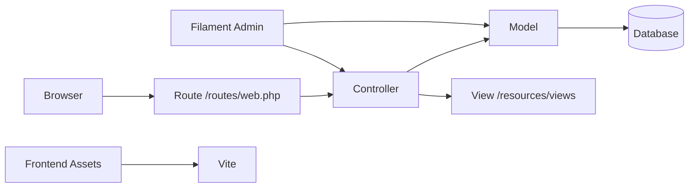

# Desa Sukamaju - Sistem Informasi Desa

Sistem informasi desa yang dibangun dengan Laravel dan Filament untuk menampilkan profil desa, berita, data statistik, UMKM, dan peta desa secara terstruktur.

## Badge

<!-- TODO: tambahkan badge build, versi, atau lisensi jika tersedia di repository atau CI -->

## Preview

<!-- TODO: tambahkan screenshot atau GIF utama aplikasi -->

## Fitur utama

- Halaman profil desa
- Daftar berita dan detail berita per slug
- Katalog UMKM dan detail produk
- Infografis desa berbasis data statistik
- Peta desa berbasis Google Maps
- Panel admin menggunakan Filament

## Demo

<!-- TODO: tambahkan link demo GitHub Pages / Codespaces jika tersedia -->

## Instalasi

Persyaratan sistem:

- PHP 8.2 atau lebih tinggi
- Composer
- Node.js dan npm
- Database yang didukung Laravel, seperti SQLite, MySQL, atau PostgreSQL

Langkah instalasi:

```bash
git clone https://github.com/muisnryn/DesaSukamaju-FIlament.git
cd DesaSukamaju-FIlament
composer install
cp .env.example .env
php artisan key:generate
php artisan migrate
php artisan db:seed
npm install
npm run dev
php artisan serve
```

Setelah proses selesai, aplikasi dapat diakses di:

```text
http://127.0.0.1:8000
```

## Cara pakai

### Contoh sederhana

1. Buka halaman utama aplikasi untuk melihat profil desa, berita terbaru, dan ringkasan data statistik.
2. Akses halaman berita untuk melihat daftar artikel dan detail per judul atau slug.
3. Buka halaman infografis untuk melihat data penduduk, APBDes, dan indikator terkait.
4. Gunakan halaman peta desa untuk melihat lokasi penting di wilayah desa.

### Lanjutan

- Akses fitur UMKM dan produk melalui katalog yang tersedia di aplikasi publik.
- Manajemen data dapat dilakukan melalui panel admin Filament sesuai konfigurasi aplikasi.
- Pastikan file `.env` telah disesuaikan sebelum menjalankan migrasi dan server aplikasi.

## Screenshot sistem

<details>
<summary>Halaman utama dan fitur aplikasi</summary>

<!-- TODO: tambahkan screenshot halaman utama, halaman berita, halaman infografis, halaman peta, dan panel admin -->
</details>

## Arsitektur



Arsitektur aplikasi mengikuti pola MVC Laravel:

- `routes/web.php` menangani rute publik seperti profil, berita, infografis, dan peta desa.
- `app/Http/Controllers` berisi logika request dan pengambilan data.
- `app/Models` digunakan untuk mengakses data desa, statistik, berita, dan informasi produk.
- `resources/views` berisi tampilan halaman yang ditampilkan ke pengguna.
- `app/Filament` menyediakan panel admin untuk pengelolaan data.

## Konfigurasi

Berikut variabel utama yang terdapat pada file `.env.example`:

| Variabel | Contoh | Keterangan |
| --- | --- | --- |
| `APP_NAME` | `Laravel` | Nama aplikasi |
| `APP_ENV` | `local` | Lingkungan aplikasi |
| `APP_DEBUG` | `true` | Mengaktifkan mode debug |
| `APP_URL` | `http://localhost` | URL aplikasi utama |
| `DB_CONNECTION` | `sqlite` | Driver database yang digunakan |
| `DB_HOST` | `127.0.0.1` | Host database MySQL/PostgreSQL |
| `DB_PORT` | `3306` | Port database |
| `DB_DATABASE` | `sukamaju_filament` | Nama database |
| `DB_USERNAME` | `root` | Username database |
| `DB_PASSWORD` | `` | Password database |
| `SESSION_DRIVER` | `database` | Driver session |
| `CACHE_STORE` | `database` | Driver cache |
| `QUEUE_CONNECTION` | `database` | Driver antrian |

Catatan:

- Konfigurasi database dapat menggunakan SQLite atau MySQL sesuai kebutuhan.
- Sesuaikan nilai pada file `.env` sebelum menjalankan migrasi dan server aplikasi.

## Kontribusi

Kontribusi sangat diterima. Pastikan perubahan yang Anda buat sudah diuji sebelum dikirimkan melalui pull request.

## Lisensi

Project ini menggunakan lisensi MIT sesuai pengaturan pada `composer.json`.

## Kontak

<!-- TODO: tambahkan informasi kontak maintainer atau tim pengelola jika tersedia -->
